# Taller 4: Datos Abiertos de Colombia (Flutter)

Aplicación móvil desarrollada en Flutter que consume datos abiertos de la [API Colombia](https://api-colombia.com/) (documentación Swagger disponible en [Swagger API Colombia](https://api-colombia.com/swagger/index.html)). El proyecto implementa una arquitectura por capas, navegación avanzada con rutas nombradas utilizando `go_router`, gestión de estados asíncronos (cargando, éxito, error con reintento y lista vacía) y variables de entorno para una configuración desacoplada.

**URL Base de la API:** [https://api-colombia.com/api/v1/](https://api-colombia.com/api/v1/)

---

## 1. Endpoints Seleccionados

Se seleccionaron 5 endpoints que devuelven listas estructuradas con identificador único (`id`):

| Endpoint | Descripción | Identificador / Parámetro |
| :--- | :--- | :--- |
| `/Department` | Departamentos de Colombia, capitales, superficie, población y prefijos telefónicos. | `id` (int) |
| `/President` | Presidentes históricos de Colombia con fotografía, partido político y periodo de gobierno. | `id` (int) |
| `/TouristicAttraction` | Sitios turísticos de interés nacional, descripciones, coordenadas y fotografías. | `id` (int) |
| `/Region` | Regiones naturales y geográficas de Colombia con su descripción y biodiversidad. | `id` (int) |
| `/TypicalDish` | Platos típicos de la gastronomía colombiana, ingredientes, departamento e imagen. | `id` (int) |

---

## 2. Arquitectura y Estructura del Proyecto

El código fuente sigue el patrón de separación por capas en `lib/`:

```text
lib/
├── config/
│   └── env_config.dart          # Lectura y acceso a variables de entorno (.env)
├── models/                      # Clases de dominio con fromJson y toJson
│   ├── department.dart
│   ├── president.dart
│   ├── region.dart
│   ├── touristic_attraction.dart
│   └── typical_dish.dart
├── routes/
│   └── app_router.dart          # Configuración de GoRouter (rutas nombradas y errorBuilder)
├── services/                    # Lógica de peticiones HTTP, manejo de excepciones y timeouts
│   ├── api_exception.dart
│   └── api_service.dart
├── themes/
│   └── app_theme.dart           # Tema global Material 3, paleta de colores y tipografía
├── views/                       # Pantallas principales de la aplicación
│   ├── dashboard_view.dart      # Pantalla de inicio con Cards de selección
│   ├── detail_view.dart         # Vista de detalle con consumo por ID y soporte de extra
│   └── list_view.dart           # Listado con ListView.builder y manejo de estados
├── widgets/                     # Componentes visuales desacoplados y reutilizables
│   ├── dashboard_card.dart      # Tarjeta del Dashboard con ícono y descripción
│   ├── empty_widget.dart        # Vista informativa para listas vacías
│   ├── error_widget.dart        # Vista de error con mensaje claro y botón de reintento
│   ├── list_item_card.dart      # Tarjeta de elemento de lista con soporte de imagen
│   └── loading_widget.dart      # Indicador de progreso circular con mensaje
└── main.dart                    # Punto de entrada, inicialización de dotenv y MaterialApp.router
```

### Descripción de Capas:
- **`config/`**: Centraliza el acceso seguro a variables de configuración mediante la clase `EnvConfig`, evitando URLs quemadas en el código.
- **`models/`**: Define las entidades de datos con tipado fuerte, constructores `fromJson` con manejo seguro de campos nulos (`null-safety`) y serialización a `toJson`.
- **`services/`**: Encapsula todas las llamadas HTTP (`http.get`) con validación de códigos de respuesta (`statusCode == 200`), decodificación UTF-8 para soporte de tildes y eñes, tiempos de espera (`timeout(15s)`) y captura de errores de red (`SocketException`, `TimeoutException`, `FormatException`) mapeados a `ApiException`.
- **`routes/`**: Define la navegación declarativa usando `go_router`, con rutas nombradas, parámetros por URL (`pathParameters`) y pantalla de fallback (`errorBuilder`).
- **`themes/`**: Configura `ThemeData` con `Material 3`, personalizando colores primarios y secundarios, estilos de tarjetas, botones y tipografías.
- **`views/`**: Orquesta el flujo de interacción del usuario mediante pantallas aisladas (Dashboard, Listado y Detalle).
- **`widgets/`**: Componentes atómicos reusables que previenen la duplicación de código en la interfaz.

---

## 3. Paquetes Utilizados

| Paquete | Versión | Propósito en el Proyecto |
| :--- | :--- | :--- |
| [`http`](https://pub.dev/packages/http) | `^1.6.0` | Cliente HTTP para consumir los endpoints REST de la API Colombia, gestionando respuestas, códigos de estado y decodificación de bytes. |
| [`go_router`](https://pub.dev/packages/go_router) | `^18.1.1` | Enrutador declarativo para Flutter que gestiona rutas nombradas, paso de parámetros de URL (`pathParameters`), objetos `extra` y manejo de rutas desconocidas. |
| [`flutter_dotenv`](https://pub.dev/packages/flutter_dotenv) | `^6.0.1` | Gestión de variables de entorno mediante archivos `.env`, permitiendo cambiar URLs base sin recompilar código. |

---

## 4. Tabla de Rutas (`go_router`)

| Nombre de Ruta (`name`) | Path (`path`) | Parámetros (`pathParameters`) | Objeto `extra` | Descripción |
| :--- | :--- | :--- | :--- | :--- |
| `dashboard` | `/` | Ninguno | Ninguno | Pantalla inicial con tarjetas para cada categoría de datos. |
| `list` | `/list/:endpoint` | `endpoint`: Nombre del recurso (`Department`, `President`, etc.) | Ninguno | Pantalla que lista los registros del recurso especificado. |
| `detail` | `/detail/:endpoint/:id` | `endpoint`: Recurso base<br>`id`: Identificador numérico del elemento | `item`: `Map<String, dynamic>?` (opcional) | Pantalla de detalle completo. Si no se pasa `extra`, consulta el registro por `id` vía HTTP. |

---

## 5. Ejemplos Reales de Respuesta JSON (Fase 0)

### 5.1. Department (`GET /api/v1/Department/3`)
```json
{
  "id": 3,
  "name": "Arauca",
  "description": "Arauca es uno de los treinta y dos departamentos que, junto con Bogotá, Distrito Capital, forman la República de Colombia. Su capital es la homónima Arauca. Está ubicado al este del país, en la región Orinoquía, limitando al norte y este con Venezuela, al sur con Vichada y Casanare, y al oeste con Boyacá",
  "cityCapitalId": 143,
  "municipalities": 7,
  "surface": 23818,
  "population": 304978,
  "phonePrefix": "7",
  "countryId": 1,
  "regionId": 3
}
```

### 5.2. President (`GET /api/v1/President/3`)
```json
{
  "id": 3,
  "image": "https://upload.wikimedia.org/wikipedia/commons/d/db/Rafael_Nunez.JPG",
  "name": "Rafael",
  "lastName": "Nuñez Moledo",
  "startPeriodDate": "1887-06-04",
  "endPeriodDate": "1888-08-07",
  "politicalParty": "Partido nacional",
  "description": "Rafael Wenceslao Núñez Moledo fue un abogado, periodista, escritor, político y militar colombiano, presidente del país en 4 ocasiones.",
  "cityId": 210
}
```

### 5.3. TouristicAttraction (`GET /api/v1/TouristicAttraction/36`)
```json
{
  "id": 36,
  "name": "Hacienda napoles",
  "description": "La Hacienda Nápoles es el nombre que tuviera en el pasado lo que hoy se conoce y reconoce como el Parque Temático Hacienda Nápoles, centro de entretenimiento familiar y santuario de fauna.",
  "images": [
    "https://upload.wikimedia.org/wikipedia/commons/thumb/4/4a/P%C3%B3rtico_Hacienda_N%C3%A1poles.JPG/800px-P%C3%B3rtico_Hacienda_N%C3%A1poles.JPG"
  ],
  "latitude": "5.887894",
  "longitude": "-74.6418",
  "cityId": 88
}
```

### 5.4. Region (`GET /api/v1/Region/1`)
```json
{
  "id": 1,
  "name": "Caribe",
  "description": "La región caribe es una de las regiones más importantes del territorio Colombiano, en sus costas hospeda la formación montañosa más grande del mundo: La Sierra Nevada de Santa Marta y el Parque Natural del Tayrona."
}
```

### 5.5. TypicalDish (`GET /api/v1/TypicalDish/1`)
```json
{
  "id": 1,
  "name": "Bandeja Paisa",
  "description": "La bandeja paisa es el orgullo de la cocina paisa y uno de los platos más emblemáticos de Colombia. Originaria de Antioquia y los departamentos vecinos de Caldas, Risaralda y Quindío.",
  "ingredients": "Frijoles, arroz, carne molida, chicharrón, huevo, plátano maduro, chorizo, arepa, aguacate.",
  "imageUrl": "https://apicolombiastorage.blob.core.windows.net/typicaldishes/1. Bandeja Paisa.jpg",
  "departmentId": 2
}
```

---

## 6. Capturas de la Aplicación

Todas las capturas fueron tomadas con renderizado de fuentes reales y datos auténticos de la API:

### 6.1. Dashboard Principal
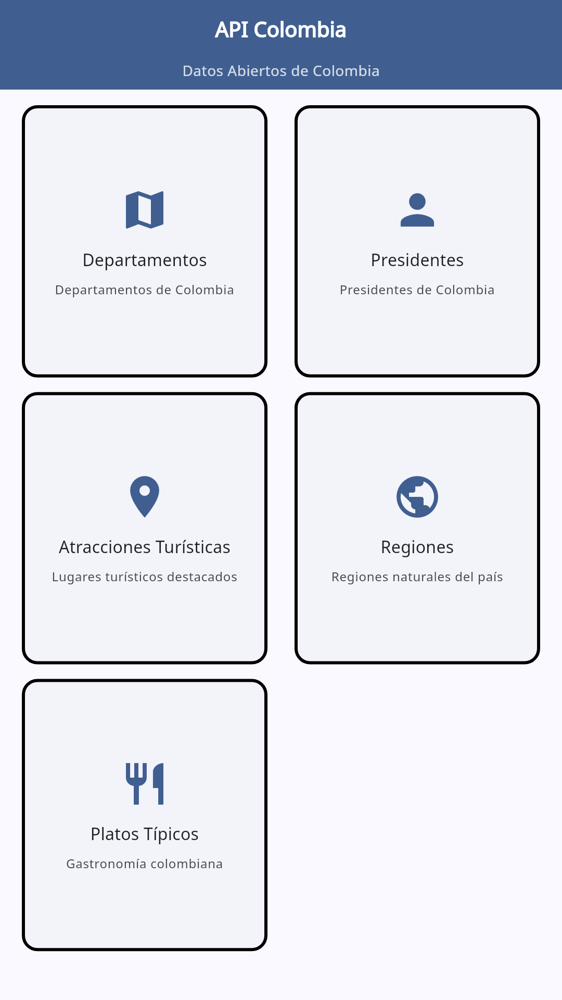

### 6.2. Listados y Detalles por Endpoint

| Endpoint | Listado | Detalle |
| :--- | :---: | :---: |
| **Departamentos** | 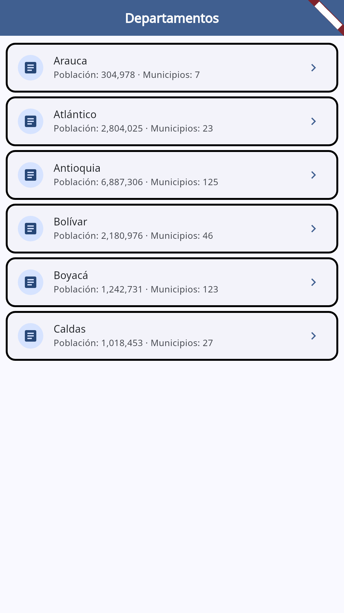 | 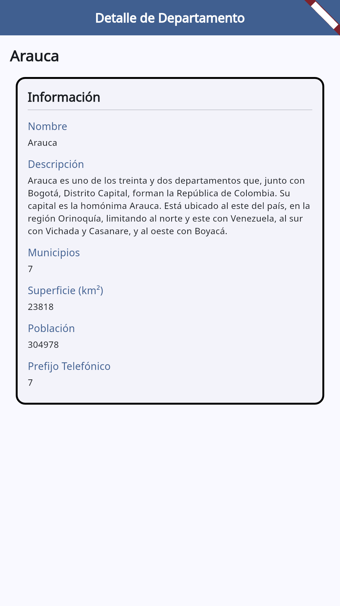 |
| **Presidentes** | 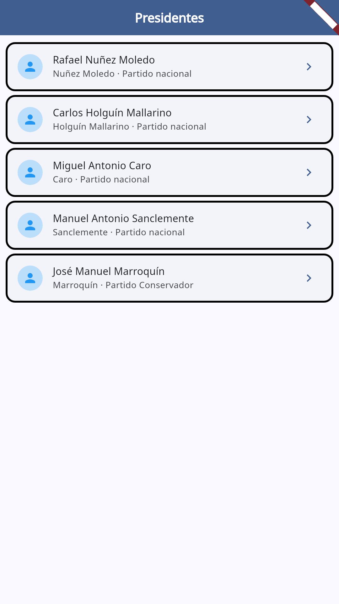 | 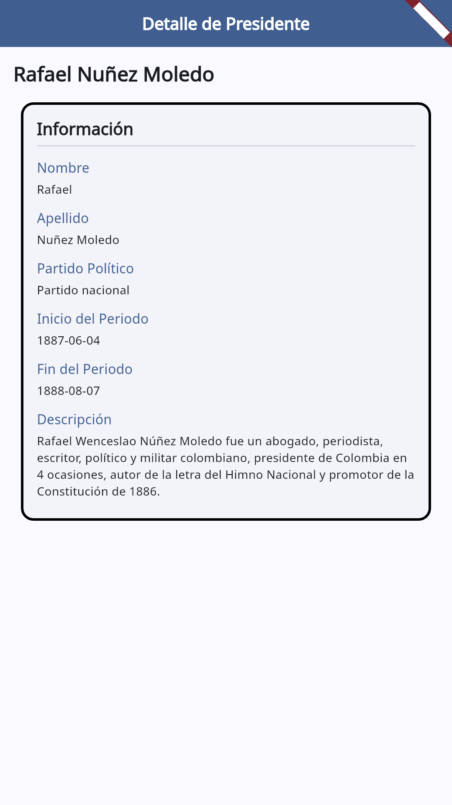 |
| **Atracciones Turísticas** | 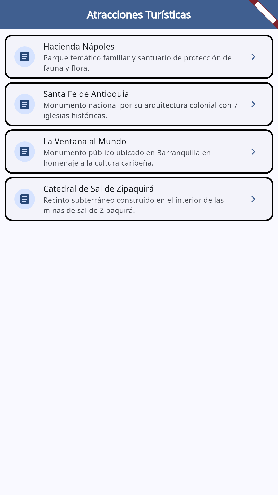 | 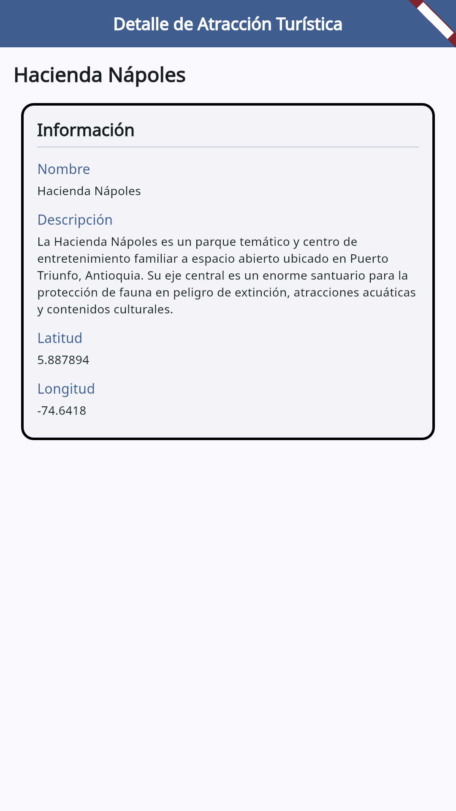 |
| **Regiones** | 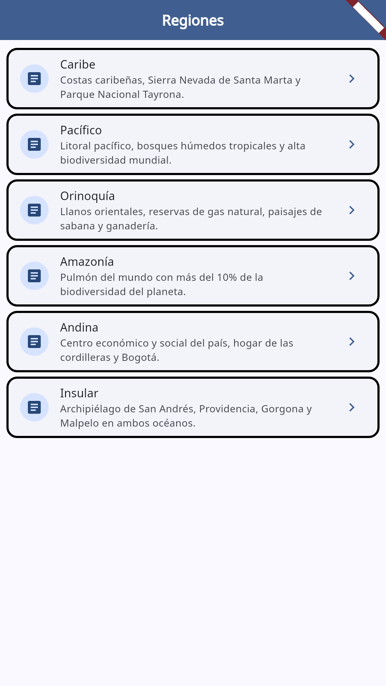 | 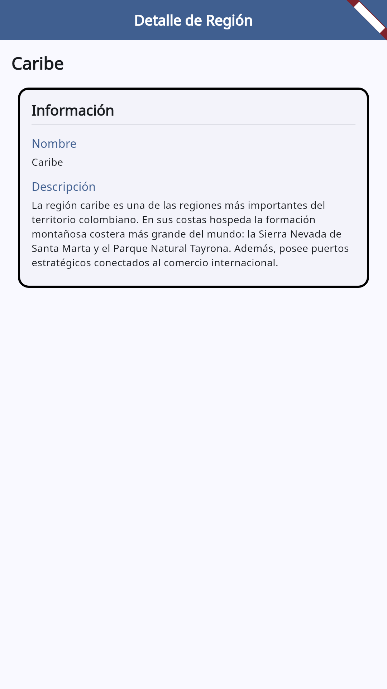 |
| **Platos Típicos** | 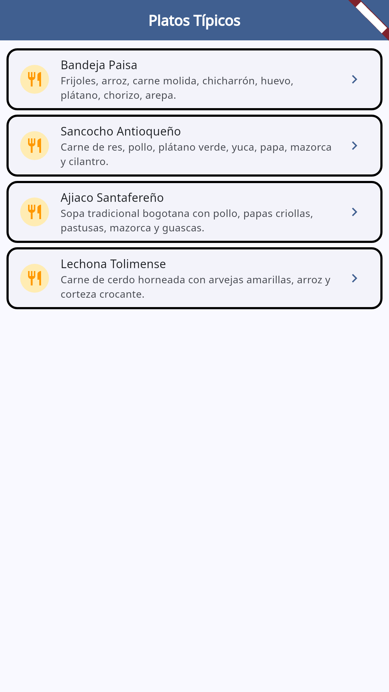 | 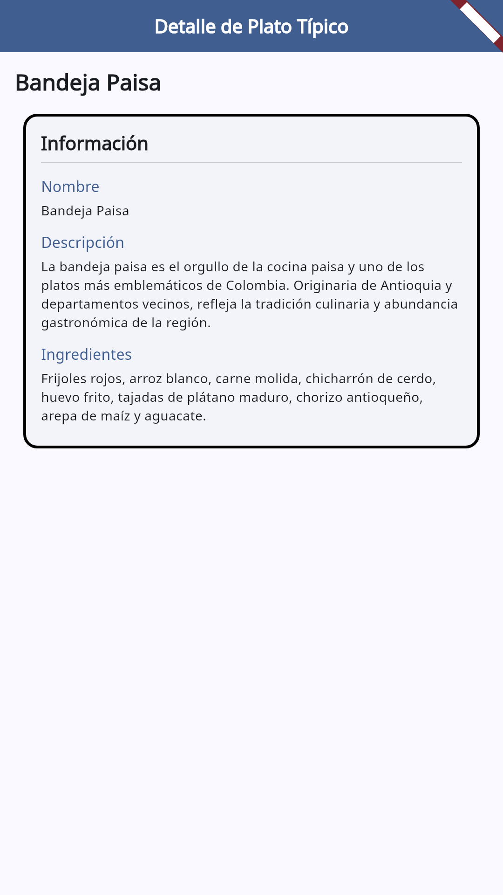 |

### 6.3. Manejo de Estados Asíncronos

| Estado Cargando | Estado Error con Reintento | Estado Lista Vacía |
| :---: | :---: | :---: |
| 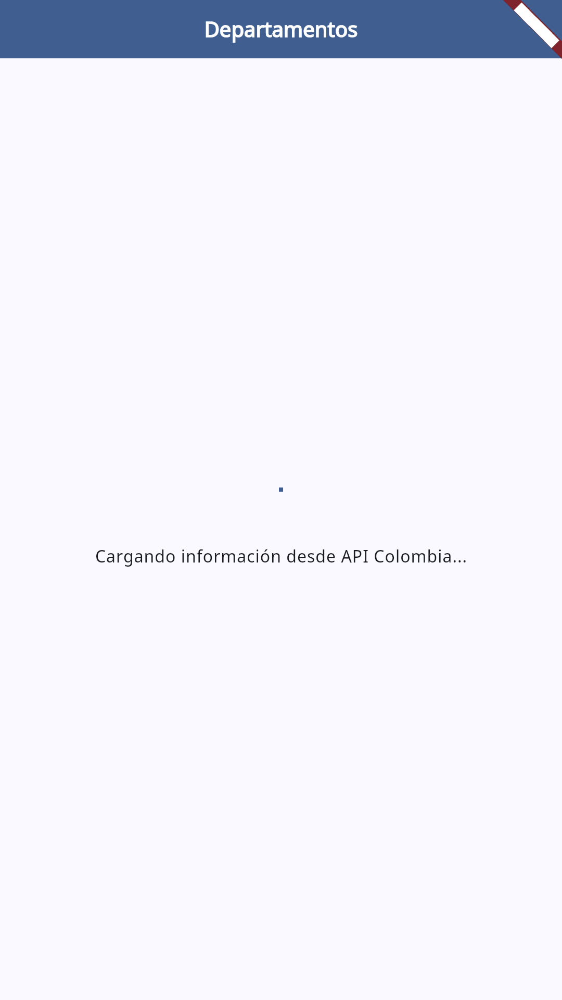 | 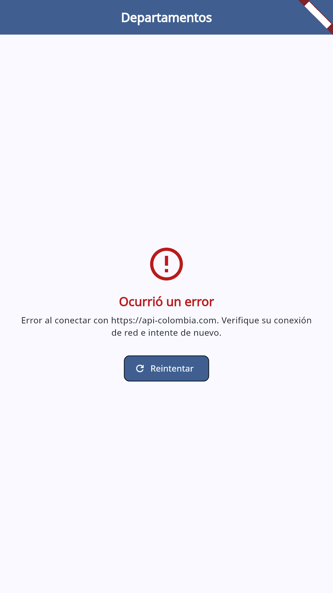 | 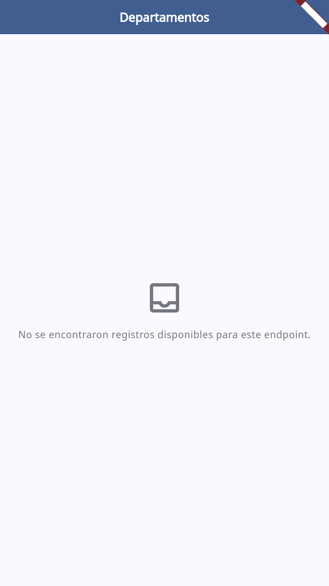 |

---

## 7. Instrucciones de Instalación y Ejecución

### Prerrequisitos
- Flutter SDK (versión `>=3.13.0` o superior).
- Dispositivo Android/iOS o entorno Desktop (Linux/macOS/Windows).

### Pasos:
1. Clonar el repositorio:
   ```bash
   git clone https://github.com/Santi202305/taller_datos_abiertos.git
   cd taller_datos_abiertos
   ```
2. Instalar dependencias:
   ```bash
   flutter pub get
   ```
3. Verificar archivo de variables de entorno:
   El archivo `.env` ya se encuentra incluido con la configuración pública por defecto:
   ```env
   BASE_URL=https://api-colombia.com/api/v1
   ```
4. Ejecutar pruebas unitarias y de widgets:
   ```bash
   flutter test
   ```
5. Ejecutar la aplicación:
   ```bash
   flutter run
   ```

---

## 8. Flujo GitFlow Implementado

Se implementó el flujo GitFlow respetando los lineamientos de ramas y commits atómicos con prefijos convencionales:

1. **Ramas Principales:**
   - `main`: Rama de producción y versión estable.
   - `dev`: Rama de desarrollo e integración continua.
2. **Rama de Trabajo:**
   - `feature/taller_api_colombia`: Rama creada a partir de `dev` donde se desarrollaron todas las funcionalidades del taller.
3. **Flujo de Integración:**
   - Commits atómicos (`feat:`, `chore:`, `test:`, `docs:`).
   - Pull Request de `feature/taller_api_colombia` hacia `dev`.
   - Merge de `feature/taller_api_colombia` a `dev`.
   - Merge final de `dev` hacia `main`.
